<p align="center">
  <a href="https://aventrade.app">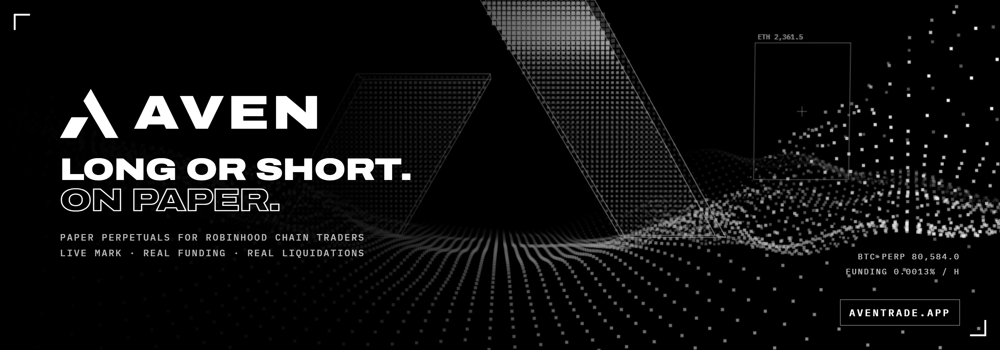</a>
</p>

<p align="center">
  <a href="https://aventrade.app"></a>
  <a href="https://github.com/aventrade/aven/actions/workflows/ci.yml"></a>
  
  
  
  
  
  <a href="LICENSE"></a>
</p>

<p align="center">
  <a href="https://aventrade.app"><b>Site</b></a> ·
  <a href="https://aventrade.app/trade/"><b>Open the app</b></a> ·
  <a href="https://aventrade.app/docs/"><b>Docs</b></a> ·
  <a href="docs/ENGINE.md"><b>Engine spec</b></a> ·
  <a href="docs/ROBINHOOD-STOCKS.md"><b>On-chain stock pricing</b></a> ·
  <a href="docs/COMMANDS.md"><b>Command line</b></a> ·
  <a href="CHANGELOG.md"><b>Changelog</b></a> ·
  <a href="https://x.com/aven_trade"><b>X</b></a>
</p>

---

Paper trading usually lies in the same three places. The price is a delayed snapshot, funding doesn't exist, and
nothing happens while you're not looking. Lose on paper like that and you've learned nothing about losing for real.

**Aven is a paper perpetuals exchange that keeps the parts that hurt.** Twenty-nine markets: crypto and macro on
Hyperliquid's live mark with its real hourly funding, and the thirteen official stock tokens on Robinhood Chain,
priced straight from their pools on-chain and filled at what a swap of your size would really get. Liquidations,
stops and resting orders fire on the real price, and when you come back after a night away the market you missed
is replayed minute by minute against your account. The money is the only fake part: 50,000 aUSD, no login, no
top-up, no wallet, no keys.

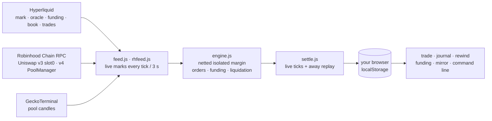

## What makes it real

| | What you see | Where it comes from |
|---|---|---|
| **Mark price** | PnL, liquidation, stops and targets all trigger on the mark, never the last trade | Hyperliquid `activeAssetCtx`, every second, all markets |
| **Funding** | Paid out of your margin every hour, on the hour, at the live rate | Hyperliquid's hourly rate and its funding history |
| **Stock fills** | A bigger order fills worse, LP fee included; orders that would move the pool more than 1.5% are refused | Uniswap v3/v4 swap maths on the pool's active liquidity, read on-chain |
| **Order book** | 20 live levels, spread, depth | Hyperliquid `l2Book` |
| **Time away** | Fills, stops, funding and liquidations land when they would have | 1-minute candles and funding history replayed in order |
| **Liquidation odds** | Chance of touching your liquidation price in 24 h | That market's own hourly volatility over three days |

Everything Aven simulates rather than reads is written down in [docs/DATA-SOURCES.md](docs/DATA-SOURCES.md#what-is-simulated):
no slippage on Hyperliquid markets, no liquidation penalty, trade candles standing in for mark candles in the away
replay.

## A tour

<table>
  <tr>
    <td width="50%"><a href="https://aventrade.app/trade/">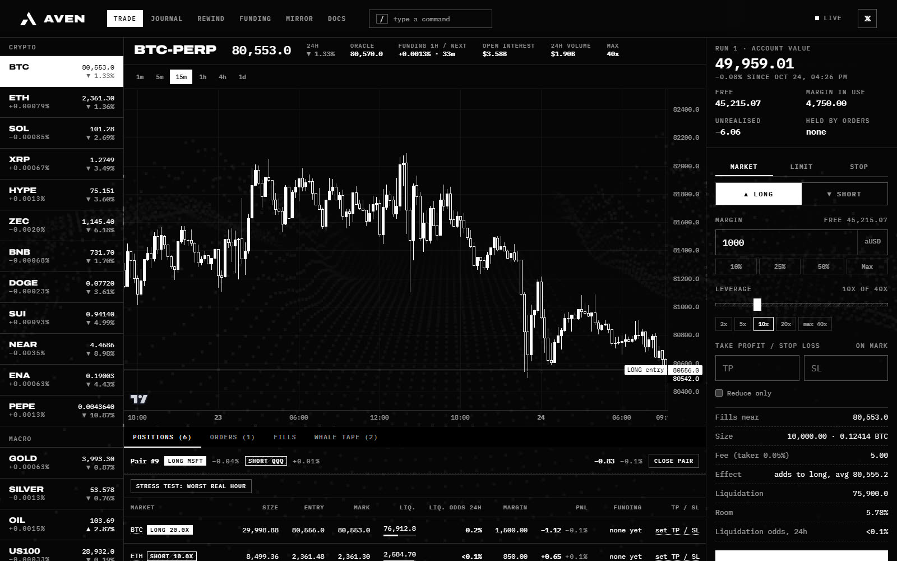</a><br><sub><b>Trade.</b> Sixteen Hyperliquid markets and thirteen Robinhood Chain stocks, a live book, positions with liquidation odds, a pair trade tracked as one spread.</sub></td>
    <td width="50%"><a href="https://aventrade.app/trade/?m=NVDA">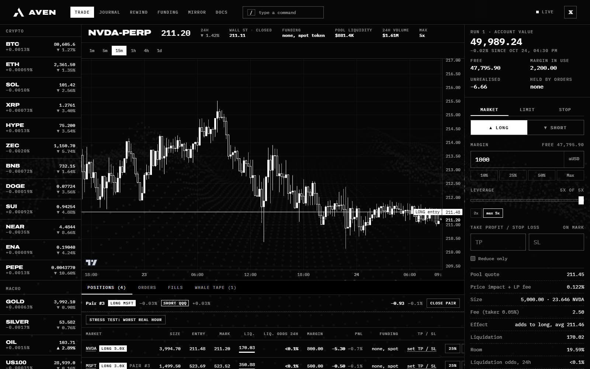</a><br><sub><b>Robinhood Chain stocks.</b> NVDA priced from its Uniswap pool on-chain; the ticket quotes the fill with price impact and LP fee; the bar shows Wall St's last trade.</sub></td>
  </tr>
  <tr>
    <td>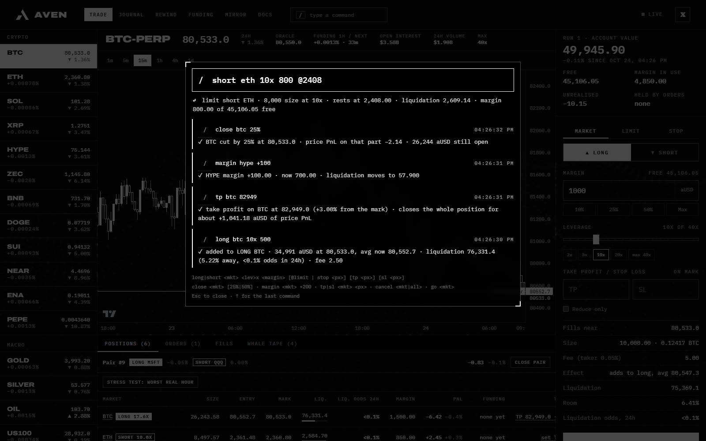<br><sub><b>Command line.</b> Press <code>/</code> and type the trade. A preview while you type, the full result after Enter.</sub></td>
    <td>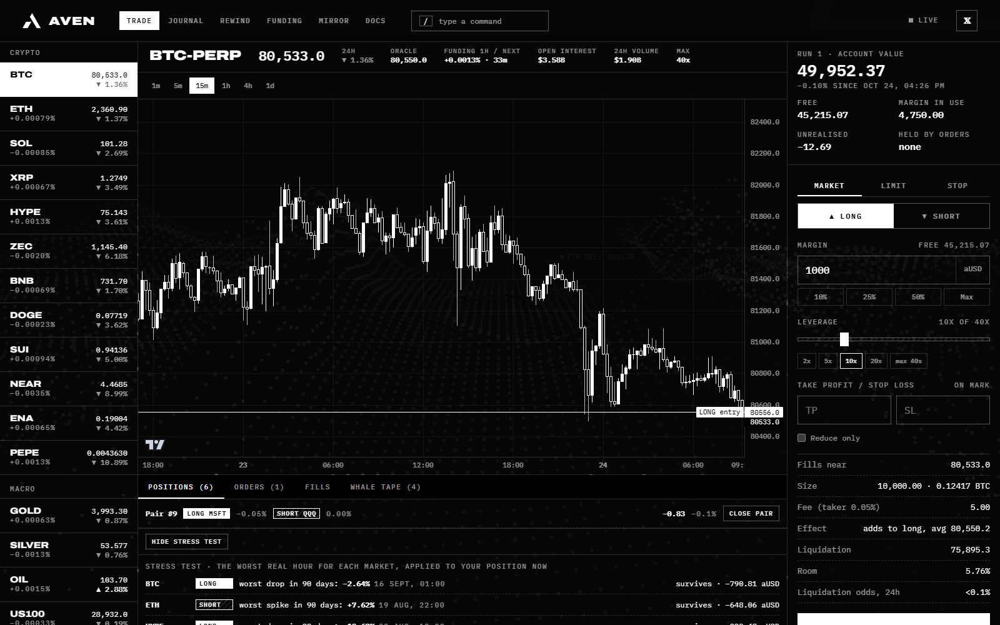<br><sub><b>Stress test.</b> Every open position against the worst real hour its market had in 90 days.</sub></td>
  </tr>
  <tr>
    <td><a href="https://aventrade.app/trade/?view=rewind">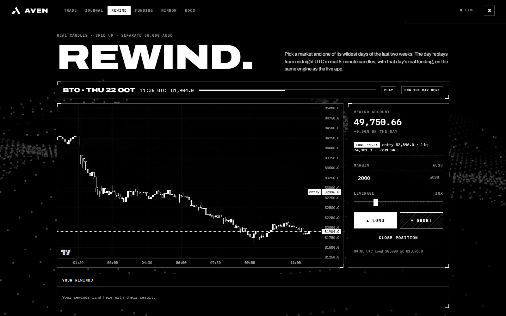</a><br><sub><b>Rewind.</b> One of the wildest days of the last two weeks, replayed in real 5-minute candles with that day's funding, on a separate account.</sub></td>
    <td><a href="https://aventrade.app/trade/?view=mirror">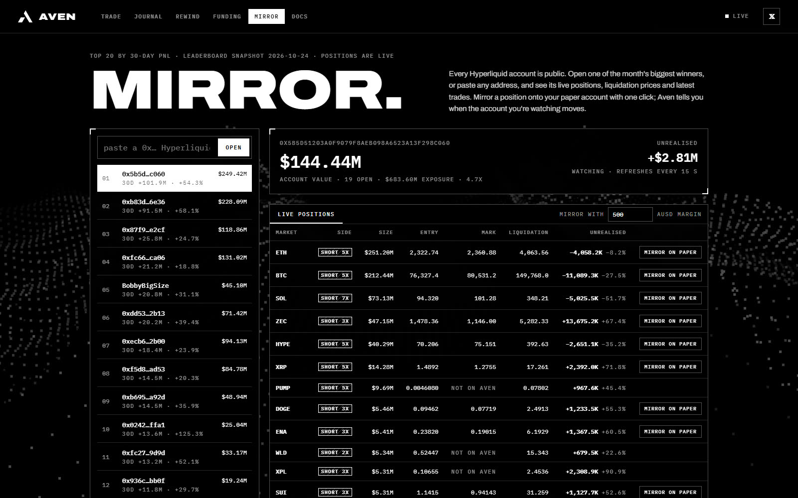</a><br><sub><b>Mirror.</b> Any Hyperliquid account's live positions and liquidation prices, copied onto paper in one click.</sub></td>
  </tr>
  <tr>
    <td><a href="https://aventrade.app/trade/?view=funding">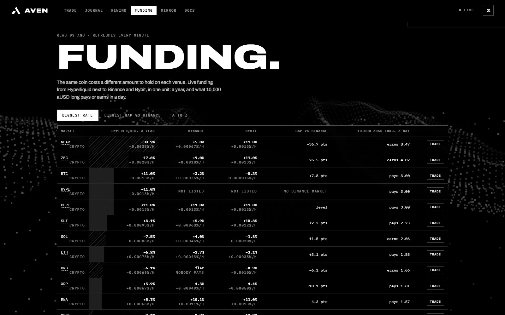</a><br><sub><b>Funding board.</b> Hyperliquid next to Binance and Bybit for the same coin, per year and per day on 10,000 aUSD.</sub></td>
    <td><a href="https://aventrade.app/trade/?view=journal">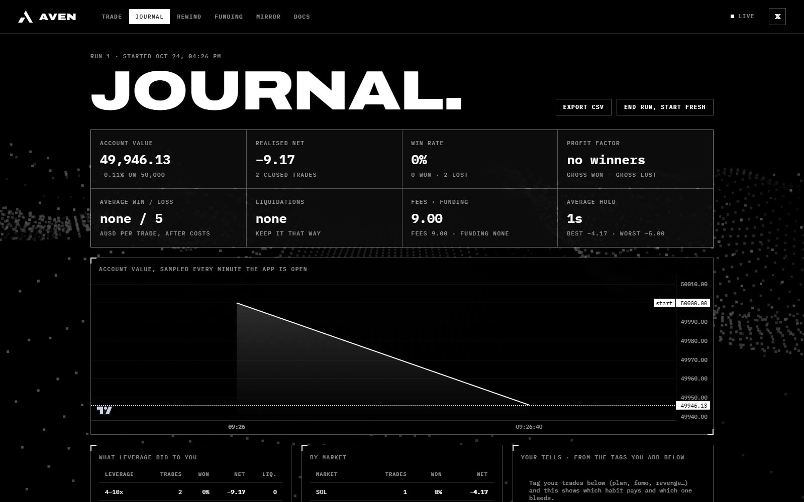</a><br><sub><b>Journal.</b> Every closed trade with fees and funding, an equity curve, breakdowns by leverage, market and habit tag.</sub></td>
  </tr>
  <tr>
    <td><a href="https://aventrade.app">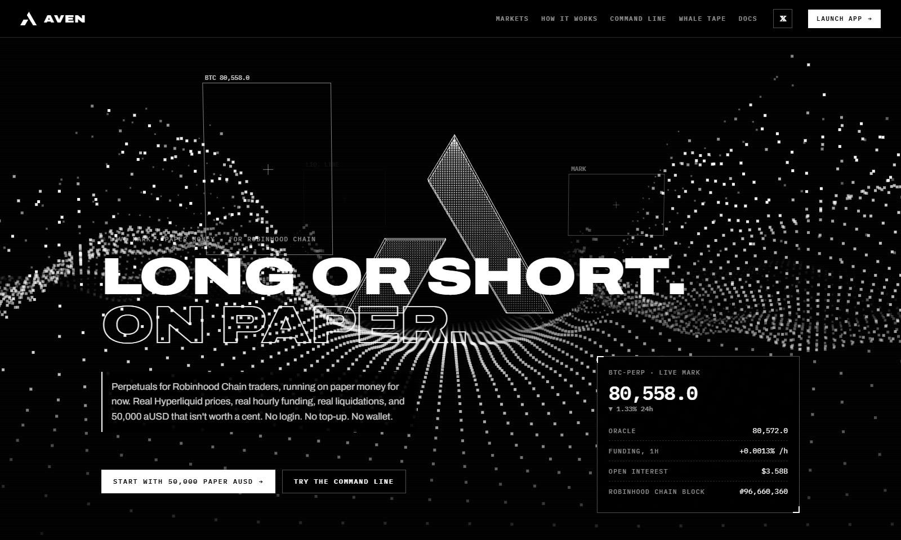</a><br><sub><b>The field.</b> A halftone terrain drawn dot by dot on a canvas; the camera flies through the A as you scroll, and every real $50K+ print sends a shockwave through it.</sub></td>
    <td>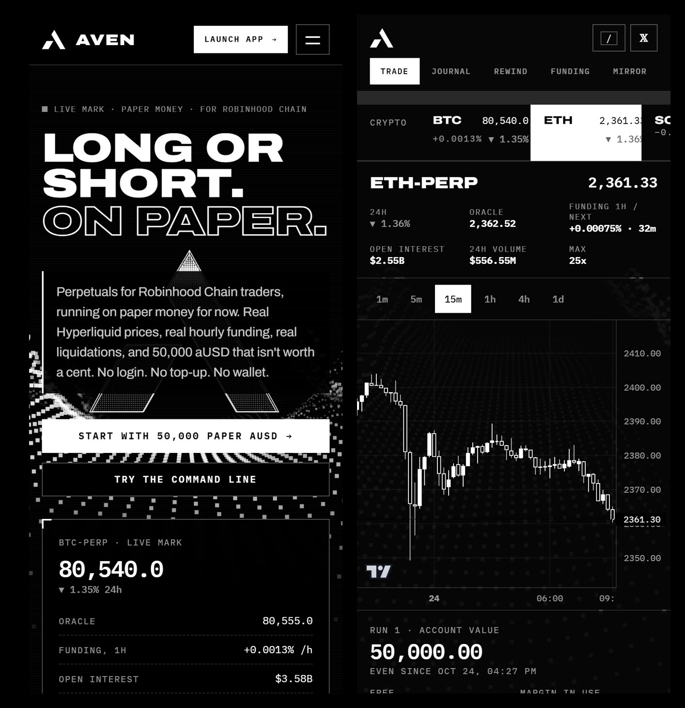<br><sub><b>On a phone.</b> The whole app, the command line included, at 360 px.</sub></td>
  </tr>
</table>

## Features

- **Perpetuals, not a price chart with buttons.** One netted, isolated-margin position per market. Adding averages
  the entry; an opposite order reduces, closes or flips it. Market, resting limit (maker fee) and stop orders,
  reduce-only, take profit and stop loss, partial closes, add or pull margin.
- **Robinhood Chain stocks.** NVDA, TSLA, AAPL, META, GOOGL, AMZN, MSFT, AMD, COIN, PLTR, MSTR, SPY, QQQ: the
  official tokens from a fixed address list, priced from on-chain pool state every three seconds. See
  [docs/ROBINHOOD-STOCKS.md](docs/ROBINHOOD-STOCKS.md).
- **Away settlement.** Close the tab at 10 p.m., come back at 8 a.m.: the stop that would have fired at 3 a.m. fired
  at 3 a.m. A market whose history can't be fetched is held back and retried rather than skipped.
- **Command line.** `long btc 20x 1000`, `short eth 10x 500 @2450`, `pair long nvda short qqq 1000 3x`,
  `alert btc above 85000`, `close sol 50%`. Full reference in [docs/COMMANDS.md](docs/COMMANDS.md).
- **Rewind, Mirror, Funding board, Stress test, Whale tape**: tools that answer a trader's question with real data
  instead of a game.
- **Journal and runs.** Win rate, profit factor, average win and loss, liquidations, fees and funding, an equity
  curve, tags (`plan`, `fomo`, `revenge`…) with notes, CSV export. A run is one 50,000 aUSD account; blow it up and
  start the next.
- **Receipts.** Any position or closed trade printed as a 1080 × 1350 paper receipt, ready to post.

## How it's built

There is no server. The site is static files on Cloudflare Workers; every visitor's browser talks to Hyperliquid,
Robinhood Chain's public RPC and GeckoTerminal directly, runs the engine, and keeps the account in `localStorage`.
No build step, no npm dependencies at runtime: plain ES modules, one vendored library
(TradingView Lightweight Charts) and two Google Fonts.

```
site/
  index.html            landing: the field, live markets, the command line sandbox
  trade/index.html      the app: trade, journal, rewind, funding, mirror views
  docs/index.html       user docs
  assets/
    engine.js           paper perpetuals engine: fills, netting, margin, liquidation, funding, orders, stats
    settle.js           live settlement and the away replay
    feed.js             Hyperliquid: websocket + REST, plus the stock feed wired in
    rhfeed.js           Robinhood Chain pools: batched eth_call, sqrtPriceX96 → USD, swap quotes, candles
    rhpools.js          the stock token / pool table, built by dev/rhprobe.mjs
    command.js          the command line parser
    risk.js             realised volatility and liquidation touch odds
    stress.js           worst-hour stress test
    rewind.js           day replays
    fundingboard.js     cross-venue funding
    mirror.js           Hyperliquid account viewer and copier
    field.js            the halftone 3D field (canvas 2D)
    card.js             share receipts
test/                   node --test suites: engine rules, parser, pool quote maths
dev/                    local server, headless-Chrome audits, media and banner renderers, pool table builder
```

Read [docs/ARCHITECTURE.md](docs/ARCHITECTURE.md) for the data flow and [docs/ENGINE.md](docs/ENGINE.md) for every
rule and formula.

## Run it

Node 20 or newer.

```bash
npm run dev          # http://localhost:8792
npm test             # engine, command parser, pool quote maths
```

Headless-Chrome checks used before every deploy (Chrome installed locally):

```bash
node dev/zeros.mjs                # no bare 0 or dash placeholder anywhere, with trades open and closed
node dev/overflow.mjs out/        # nothing past the edge at 360 and 390 px
node dev/smoke-stocks.mjs out/    # stock pricing, pool quotes, pairs, alerts
node dev/smoke-cmd.mjs out/       # the command line's preview and results, Mirror
```

Deploy: `npx wrangler deploy` (static assets, `wrangler.jsonc`).

## Today and later

**Today: paper.** Everything above, live at [aventrade.app](https://aventrade.app).
**Later: real money** on Robinhood Chain. There is no date yet and nothing to deposit today. Anyone asking you to
send funds for Aven is not Aven.

## Contributing

Bugs, data mismatches and ideas are welcome: see [CONTRIBUTING.md](CONTRIBUTING.md). A price that doesn't match its
source is the most useful report there is; there's an issue template for exactly that.

## Notes

Aven is a trading simulator. aUSD has no value and can't be bought, sold or withdrawn. Aven is an independent
project, not affiliated with Robinhood Markets, Inc., Hyperliquid, Uniswap or GeckoTerminal. Nothing here is
financial advice. Charts by [TradingView Lightweight Charts](https://www.tradingview.com/lightweight-charts/)
(Apache-2.0). Code under the [MIT license](LICENSE).
