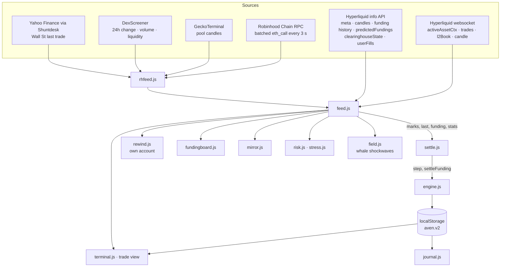

# Architecture

Aven has no server of its own. `wrangler.jsonc` publishes `site/` as static assets on Cloudflare Workers, and every
visitor's browser does the rest: it connects to the data sources, runs the engine, and keeps the account in
`localStorage`.

## The loop

1. **Load.** `feed.loadAll()` reads Hyperliquid's `metaAndAssetCtxs` (main and `xyz` dexes) for marks, funding and
   leverage caps, and the first Robinhood Chain batch.
2. **Away replay.** `settle.away()` takes every market with a position or order and replays, in time order, the
   1-minute candles (5-minute after a day, hourly after five) and the funding history since `account.seen`. A
   market whose history can't be fetched goes into `account.behind` with the time it is owed from, is left out of
   live settlement, and is retried every 45 seconds.
3. **Live.** One websocket carries every Hyperliquid market's asset context (mark, oracle, funding, open interest)
   and trades, plus the book and candles of the market on screen. The stock pools are read every three seconds.
   Every 300 ms `settle.live()` runs `engine.step()` on each market with something open and pays funding when an
   hour turns.
4. **Persist.** The account is written to `localStorage` on every change, every 30 seconds and on `pagehide`; other
   tabs follow through the `storage` event.

## Views

The app is one page, `/trade/`, with views switched in place (`?view=journal|rewind|funding|mirror`), so every
feature lives at one route. Rewind keeps its own account and never touches the live one. Mirror only reads other
accounts; copying a position goes through the same command-line path as a typed order.

## The field

`field.js` draws the landing page's terrain on a 2D canvas: about 8,000 square dots per frame, sized and shaded by
slope like halftone, with a dotted "A" monolith the camera flies through as you scroll. The ridge along the valley is
the last 120 hours of BTC closes. Each real trade of $50K or more on Hyperliquid drops an expanding ring into the
terrain, buys on one wall, sells on the other. Everything in it is a pure function of `(time, scroll)`.

## Why no backend

A backend would add a place for numbers to be changed and a bill to pay. Every source Aven uses is public and allows
browsers to call it directly, so the client does the work and the account never leaves the visitor's machine. The
cost of that choice is honest: rate limits apply per visitor, and an account doesn't follow you to another device.
